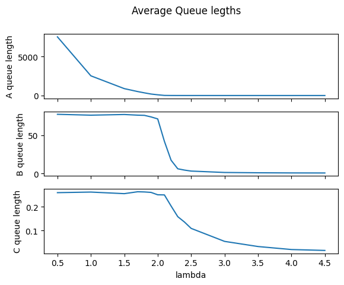
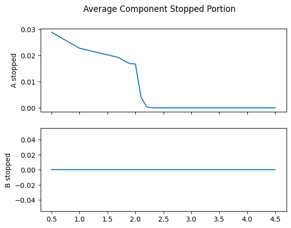
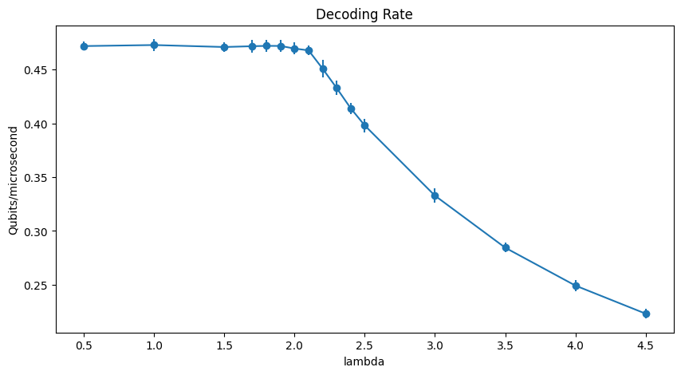
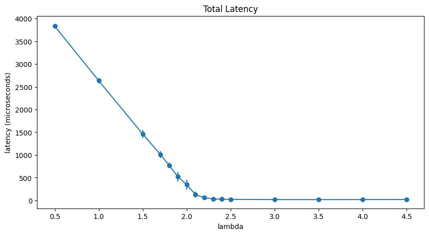
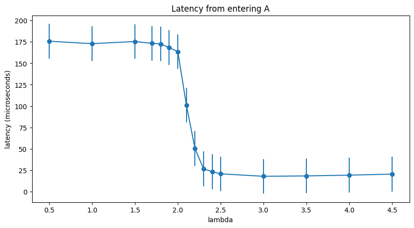
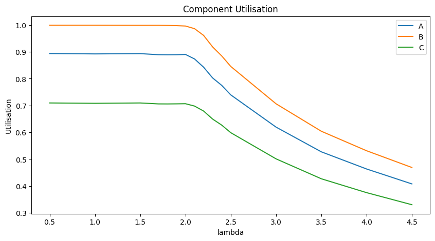
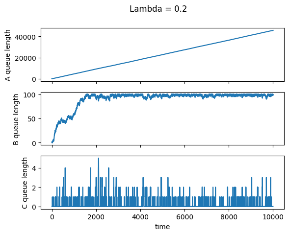
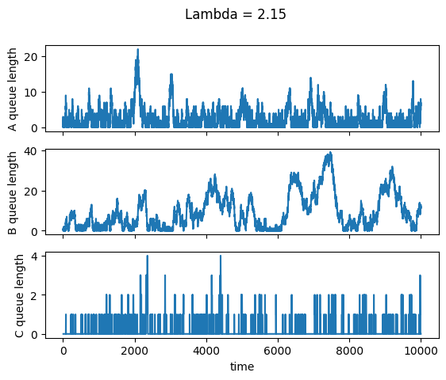
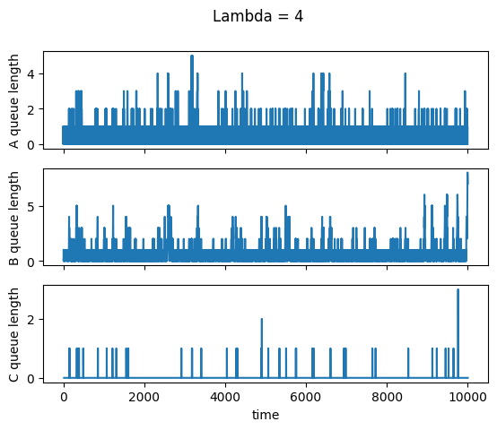

# Qubit Readout System Performance Simulation

## Overview

This project simulates a three-stage qubit readout processing system to investigate its performance under different input arrival rates. The system consists of components A, B, and C, with queues between processing stages.

The simulation is used to analyse:

- **Throughput:** the number of qubit readout messages processed per microsecond.
- **Latency:** the time taken for a qubit readout message to travel through the system and produce an output from Stage C.
- **Component utilisation:** the proportion of time each component spends processing qubits.
- **Queue dynamics:** how queue lengths and component blocking change with the input arrival rate.

The model is implemented in Python using a discrete-event simulation. Multiple simulation runs can be performed for each input parameter to estimate average performance and variability.

## Method

### Discrete-event simulation

The simulation advances time directly between events rather than using a fixed timestep. The main events are:

- Qubit arrivals into the queue for Stage A.
- Processing completions at Stages A, B, and C.

Qubit arrivals are modelled as a Poisson process with exponentially distributed inter-arrival times. The parameter $\lambda$ represents the **mean inter-arrival time**, measured in microseconds. Consequently, the mean arrival rate is $1/\lambda$ qubits per microsecond.

Each component processes one qubit at a time, with processing times sampled from the distributions specified in the simulation.

Queues are represented by their lengths rather than by storing individual qubits. This is sufficient for analysing aggregate system performance without tracking the identity or ordering of individual messages.

### Blocking and component interactions

The system uses a knock-on mechanism: after a component has been primed, processing a new qubit displaces a previously held qubit into the downstream queue.

If a downstream queue reaches capacity, the upstream component becomes blocked and cannot continue processing until space becomes available. This models backpressure and allows congestion to propagate upstream through the system.

### Data collection

The simulation records statistics throughout each run, including:

- Queue lengths over time.
- Component processing time and utilisation.
- Component blocking time.
- Qubit arrival and output times.
- Mean latency and individual observed latencies.
- Overall decoding rate (throughput).
- Final queue lengths.

Multiple runs are performed for each value of $\lambda$. Results are averaged to reduce the influence of randomness and estimate typical system behaviour.

## Assumptions

1. **Unordered queues:** Only queue lengths are tracked. FIFO ordering is not explicitly modelled because the analysis focuses on aggregate performance.
2. **Initially empty system:** All queues and components start empty. This introduces an initial transient period that may affect measured performance.
3. **Zero transfer time:** Travel time between components is assumed negligible.
4. **Single-server components:** Each component processes at most one qubit at a time.
5. **Stochastic arrivals and service times:** Arrivals and processing times follow the probability distributions defined in the model.

## Validation

The simulation is checked using conservation of qubits. At any time, the total number of qubits that have entered the system should equal the number that have exited plus the number still present in queues or components:

$$
N_{\mathrm{in}} =
N_{\mathrm{out}} +
N_{\mathrm{queues}} +
N_{\mathrm{components}}
$$

The component count includes qubits currently held or being processed at each stage, with at most one held qubit per component under the model assumptions.

The simulation is also checked against expected limiting behaviour. For sufficiently large $\lambda$, arrivals are infrequent and the system is input-limited, so the decoding rate should approach $1/\lambda$. At higher arrival rates, throughput becomes limited by the processing capacity of the system.

## Results and Analysis

### 1. Queue dynamics and blocking

For small values of $\lambda$, the system receives qubits faster than it can process them. Stage B is the primary bottleneck: its queue remains close to capacity, frequently blocking Stage A and causing qubits to accumulate in the A queue.

Stage C generally clears its queue more quickly than Stage B, so its queue remains comparatively small.

As $\lambda$ increases towards approximately $2.0$ – $2.2\mu s$, Stage B begins to clear its queue more consistently. Blocking of Stage A decreases, allowing the backlog at A to stabilise.

For larger values of $\lambda$, the system becomes increasingly underutilised. Queues are cleared more frequently, components spend more time idle, and downstream blocking becomes less common.

### 2. Throughput (decoding rate)

The maximum observed decoding rate is approximately

$$
0.47\ \text{qubits}/\mu s.
$$

For small $\lambda$, the system operates near this throughput limit. Additional arrivals cannot increase the output rate because Stage B limits the processing capacity. Instead, excess arrivals accumulate in the upstream queue.

As $\lambda$ increases towards approximately $2.0$ – $2.3\mu s$, the decoding rate begins to decrease as the system transitions towards an input-limited regime.

For $\lambda$ above approximately $2.5\mu s$, queues are generally short and the decoding rate approaches

$$
R \approx \frac{1}{\lambda}.
$$

In this regime, throughput is primarily determined by how frequently qubits arrive rather than by the processing capacity of the components.

The maximum sustainable throughput is therefore approximately $0.47$ qubits per microsecond, subject to the accuracy and duration of the simulation.

### 3. Latency

Latency is defined as the elapsed time between a qubit entering the system and its corresponding output being produced by Stage C.

For small $\lambda$, latency is high and can increase throughout the simulation. The input rate exceeds the system's sustainable processing rate, causing the queue at A to grow. Consequently, later arrivals experience longer waiting times.

Between approximately $2.0$ and $2.5\mu s$, latency decreases substantially and stabilises at around $20 \mu s$in the observed results. This corresponds to reduced queueing delays as Stage B becomes less congested and Stage A is blocked less frequently.

At larger values of $\lambda$, queueing delays become small. As arrivals become increasingly infrequent, the mean latency approaches the total mean processing time across the three stages, assuming the system is otherwise empty.

Latency measured from entry into Stage A excludes the time spent waiting in the initial A queue. Comparing these two measures shows how much of the total latency is attributable to upstream queueing. The difference is particularly significant under heavy load, where the A queue dominates the waiting time.

### 4. Component utilisation

Component utilisation is the proportion of simulated time that a component spends processing qubits.

Across the tested values of $\lambda$, Stage B has the highest utilisation, followed by Stage A. Stage C has significantly lower utilisation, indicating that it generally has sufficient capacity to process the qubits it receives.

For small $\lambda$, Stage B operates close to full utilisation. Its limited processing capacity causes upstream congestion and blocking.

Near the transition to stable operation, Stage B begins to clear its queue intermittently and spends more time idle. Utilisation across the system decreases as the arrival rate falls.

For large $\lambda$, utilisation decreases further because components frequently finish processing before additional qubits arrive.

### 5. Queue lengths over time

The following plots illustrate the different operating regimes.

#### High arrival rate: $\lambda = 0.2\mu s$

The arrival rate is high relative to the system's processing capacity. Stage B remains congested, and the queue at A accumulates a backlog.

#### Near the stability threshold: $\lambda = 2.15\mu s$

The system operates near its capacity limit. Stage B is less persistently congested, allowing Stage A to process incoming qubits without sustained backlog growth.

#### Low arrival rate: $\lambda = 4\mu s$

The system is underloaded. Queues are generally short, and components frequently become idle between qubits.

## Conclusion

The simulation demonstrates that Stage B is the primary bottleneck in the qubit readout system. Its processing capacity limits the maximum observed throughput to approximately $0.47$ qubits per microsecond.

When the mean inter-arrival time is too small, the system becomes overloaded: the A queue grows, latency increases, and Stage B remains close to full utilisation. Around $\lambda = 2.0$ – $2.2\mu s$, the system approaches the transition to stable operation. At larger values of $\lambda$, queueing delays and utilisation decrease, and throughput becomes limited by the arrival rate.

These results illustrate the trade-off between throughput, latency, and utilisation, and show how simulation can identify bottlenecks and estimate the maximum sustainable input rate of a multistage processing system.
